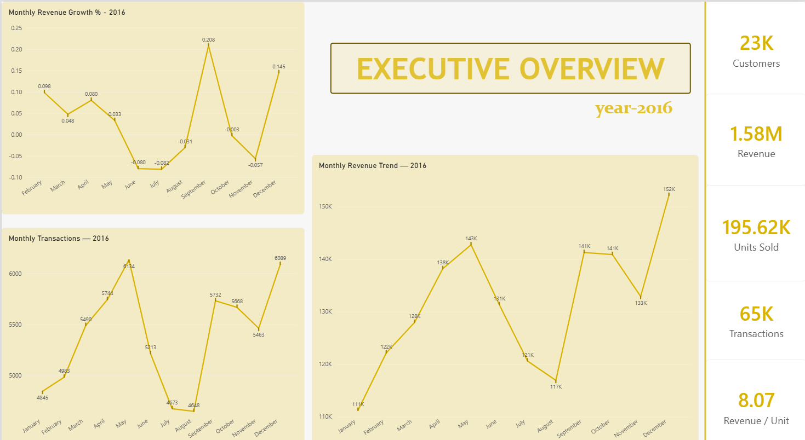
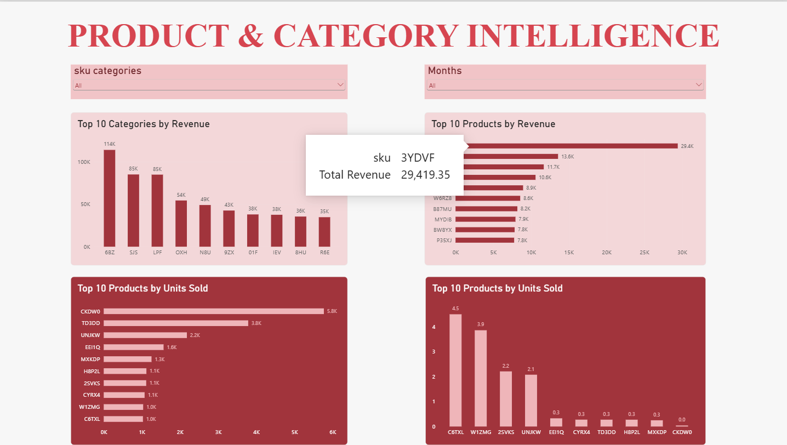
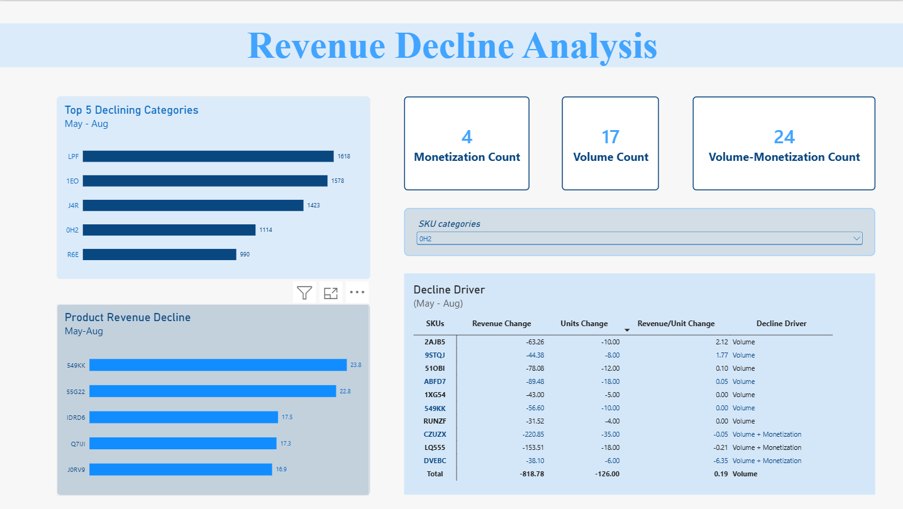
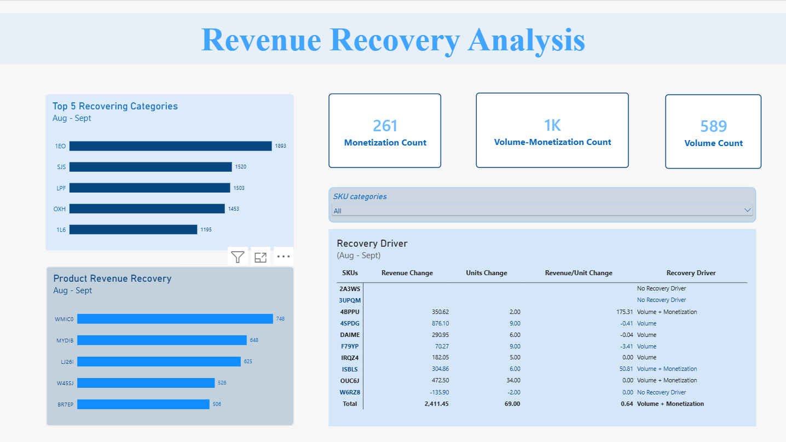

# Retail Revenue Intelligence Platform

An end-to-end retail analytics project that transforms raw point-of-sale transaction data into actionable business insights using **Python, SQL, MySQL, and Power BI**.

---

## 📌 Project Overview

This project analyzes one year of retail transaction data from **2016** to understand revenue performance, product and category behavior, and the observed drivers behind a major revenue decline and subsequent recovery.

The project follows an end-to-end analytics workflow:

```text
Raw Data
   ↓
Data Understanding
   ↓
Data Quality Assessment
   ↓
Cleaning & ETL
   ↓
Dimensional Data Modeling
   ↓
SQL KPI Analysis
   ↓
Power BI Dashboard
   ↓
Root-Cause Analysis
   ↓
Business Recommendations
```

---

## 🎯 Business Problem

The analysis focuses on answering the following business questions:

- What was the overall revenue trend during 2016?
- When did the major revenue decline occur?
- Which categories contributed most to the decline?
- Which products were responsible for the decline?
- Was the decline driven by sales volume, revenue per unit, or both?
- Which categories and products contributed to the recovery?
- What were the primary recovery drivers?
- What business actions should be prioritized?

---

## 📊 Dataset

**2016 Retail Point-of-Sale Transaction Data**

| Metric | Value |
|---|---:|
| Transaction Line Items | 131,706 |
| Unique Transactions | 64,682 |
| Unique Customers | 22,625 |
| SKUs | 5,242 |
| SKU Categories | 187 |
| Total Units Sold | 195,624.429 |
| Total Revenue | $1,578,038.62 |

### Dataset Grain

The dataset represents:

> **One SKU line item within one transaction on one date.**

Therefore, a single transaction can contain multiple rows when multiple products are purchased.

---

## 🔍 Analytical Framework

| KPI | Analysis |
|---|---|
| **KPI 1** | Overall Sales Performance |
| **KPI 2** | Time-Series Analysis |
| **KPI 3** | Product Intelligence |
| **KPI 4** | Customer Intelligence |
| **KPI 5** | Category Intelligence |
| **KPI 6** | Revenue Decline → Recovery Analysis |

---

## 📉 Key Business Finding

Revenue increased from January through May 2016 before declining from May through August.

| Period | Revenue |
|---|---:|
| May 2016 | $142,719.86 |
| August 2016 | $116,908.98 |
| September 2016 | $141,239.89 |

### May → August Decline

Revenue decreased by:

**$25,810.88 (-18.1%)**

The largest declining categories were:

1. LPF
2. 1EO
3. J4R
4. 0H2
5. R6E

The product-level analysis showed that **lower sales volume was a major recurring contributor** to the decline, while monetization effects were present for selected products.

### August → September Recovery

Revenue recovered by **$24,330.91 (+20.81%)** from August to September.

The strongest recovering categories were:

1. 1EO
2. SJS
3. LPF
4. OXH
5. 1L6

The recovery was associated with increased unit sales across several products, with product reactivation also contributing to the improvement.

---

## 📊 Power BI Dashboard

The final Power BI report contains four analytical views:

### Page 1 — Executive Overview

**What happened?**

- Total Revenue
- Total Transactions
- Total Customers
- Total Units Sold
- Revenue per Unit
- Monthly Revenue Trend
- Monthly Revenue Growth
- Monthly Transactions



### Page 2 — Product & Category Intelligence

**Where did it happen?**

- Top Categories by Revenue
- Top Products by Revenue
- Top Products by Units Sold
- Product-level analysis
- Category filtering
- Month filtering



### Page 3 — Revenue Decline Analysis

**Why did revenue decline?**

- Category revenue decline
- Product revenue decline
- Decline driver evidence
- Volume vs. monetization



### Page 4 — Revenue Recovery Analysis

**How did revenue recover?**

- Category revenue recovery
- Product recovery
- Recovery driver evidence
- Product reactivation
- Volume vs. monetization



The dashboard separates **decline analysis** from **recovery analysis** and allows category-level investigation of the underlying product drivers.

---

## 🛠️ Tools & Technologies

### Programming & Analysis

- Python
- Pandas
- Jupyter Notebook

### Database & SQL

- MySQL
- SQL

### SQL Techniques

- CTEs
- Window Functions
- Aggregations
- Joins
- KPI Development
- Time-Series Analysis

### BI & Visualization

- Power BI
- DAX
- Interactive Dashboards

### Data Engineering & Modeling

- ETL
- Dimensional Data Modeling
- Star Schema
- Fact & Dimension Tables

---

## 🗂️ Repository Structure

```text
Retail-Revenue-Intelligence/

│
├── data/
│   ├── raw/
│   │   └── scanner_data.csv
│   │
│   ├── processed/
│   │   ├── dim_customer.csv
│   │   ├── dim_date.csv
│   │   ├── dim_product.csv
│   │   ├── fact_sales.csv
│   │   └── scanner_data_clean.csv
│   │
│   └── outputs/
│       ├── decline_categories.csv
│       ├── decline_drivers.csv
│       ├── decline_products.csv
│       ├── monthly_revenue.csv
│       ├── recovery_categories.csv
│       ├── recovery_drivers.csv
│       └── recovery_products.csv
│
├── notebooks/
│   ├── 01_Data_Understanding.ipynb
│   ├── 02_Data_Quality_Assessment.ipynb
│   ├── 03_etl_workflow.ipynb
│   ├── 04_dimensional_data_modeling.ipynb
│   ├── 05_sql_analysis.ipynb
│   └── 06_business_insights.ipynb
│
├── sql/
│   ├── 01_kpi_analysis.sql
│   ├── 02_time_series_analysis.sql
│   ├── 03_product_analysis.sql
│   ├── 04_customer_intelligence.sql
│   ├── 05_category_intelligence.sql
│   ├── 06_revenue_decline_recovery.sql
│   ├── 07_sql_validation.sql
│   └── FINAL_SQL_VALIDATION.sql
│
├── dashboard/
│   └── retail analytics.pbix
│
├── docs/
│   ├── dashboard_page1.png
│   ├── dashboard_page2.png
│   ├── dashboard_page3.png
│   ├── dashboard_page4.png
│   ├── data_model.md
│   ├── data_quality_summary.md
│   └── executive_memo.md
│
├── .gitignore
├── README.md
└── requirements.txt
```

---

## 💼 Business Value

This project demonstrates how transaction-level retail data can be converted into business intelligence by:

- Establishing reliable revenue KPIs
- Identifying periods of revenue deterioration
- Locating the categories and products responsible
- Separating volume-driven and monetization-driven changes
- Identifying products contributing to revenue recovery
- Translating analytical findings into business recommendations
- Building an interactive executive dashboard

---

## ⚠️ Limitations

The dataset contains revenue, units, customers, products, and categories, but does not contain operational information such as:

- Inventory levels
- Stock availability
- Promotions
- Competitor activity
- Pricing strategy
- Marketing campaigns

Therefore, the analysis identifies **observed revenue and performance drivers**, rather than claiming specific operational causes without supporting data.

---

## 📚 Documentation

Additional project documentation:

- [Data Quality Summary](docs/data_quality_summary.md)
- [Data Model Documentation](docs/data_model.md)
- [Executive Memo](docs/executive_memo.md)

---

## 🏁 Conclusion

The Retail Revenue Intelligence Platform demonstrates an end-to-end approach to retail analytics — from raw transaction data and data quality assessment to dimensional modeling, SQL analysis, Power BI reporting, root-cause analysis, and business recommendations.

The project moves beyond simply identifying **that revenue changed** to understanding **where the change occurred, which products contributed to it, and whether the change was associated with volume or monetization**.