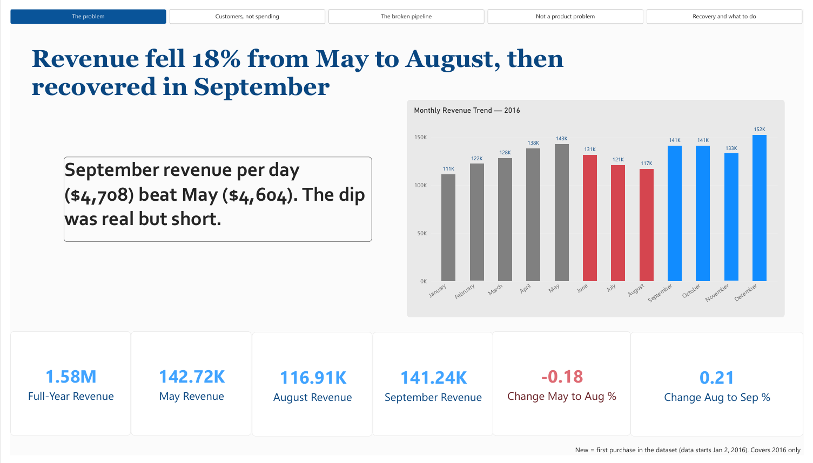
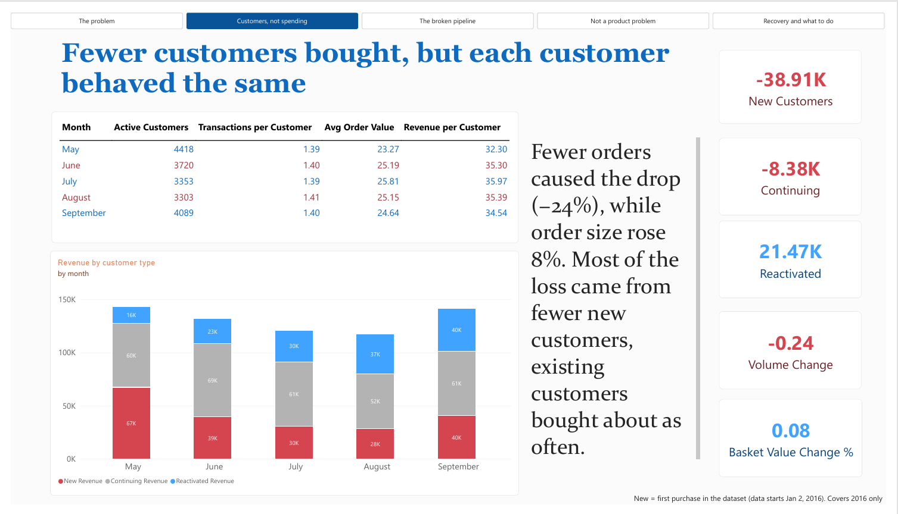
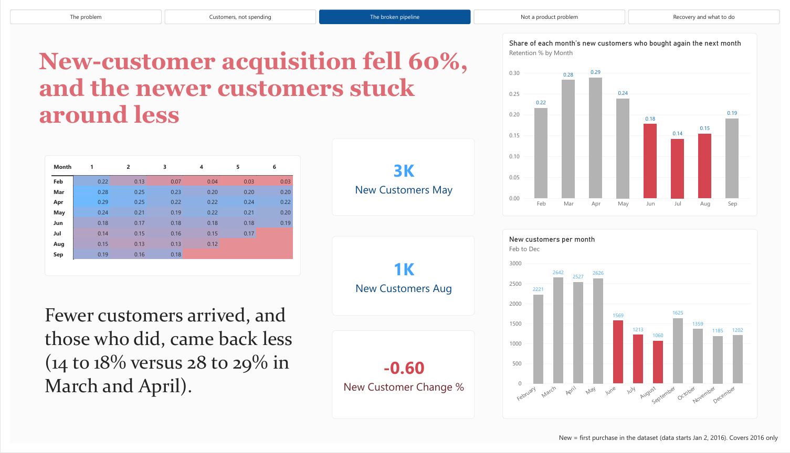
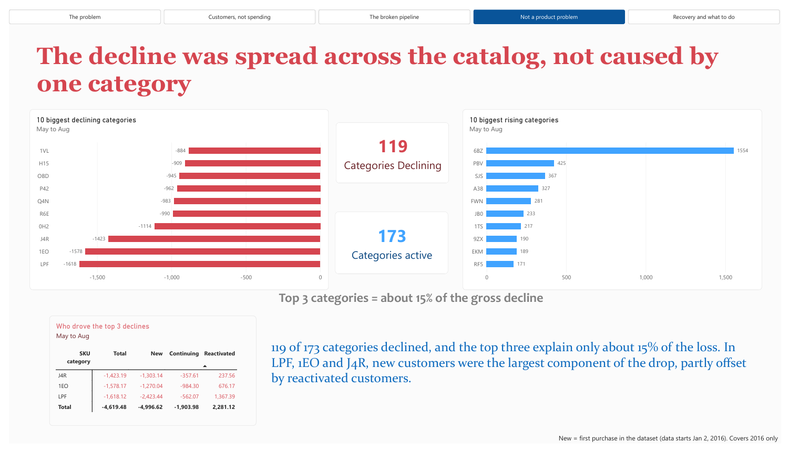
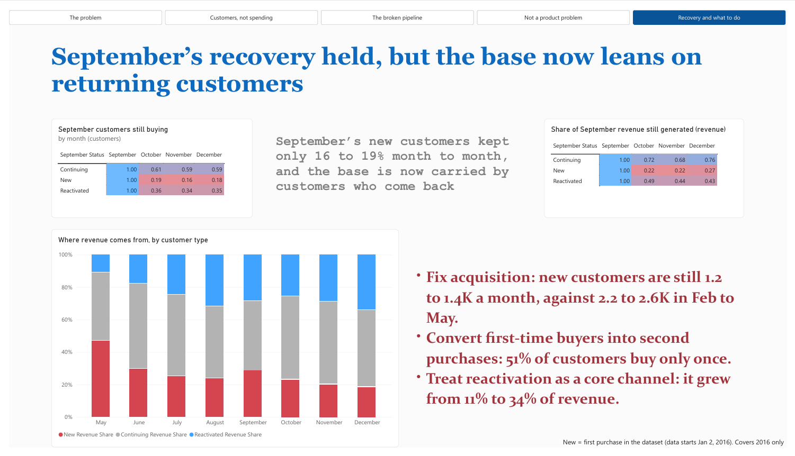

# Dashboard Story

**File:** `powerbi/analytics.pbix` · **Pages:** 5 · **Data:** star schema (`fact_sales`, `dim_date`, `dim_customer`, `dim_product`)

The dashboard is a five-step argument. Each page answers the question the previous page raises, and every page title states its finding, so the titles alone tell the story.

> **In one sentence:** revenue fell 18% from May to August and recovered in September. The cause was a collapse in new-customer acquisition, not smaller baskets or a single product category, and the recovery restored revenue without restoring acquisition.

| # | Question | Page title |
|---|---|---|
| 1 | How big was the problem? | Revenue fell 18% from May to August, then recovered in September |
| 2 | Did people spend less, or did fewer people buy? | Fewer customers bought, but each customer behaved the same |
| 3 | Which customers disappeared? | New-customer acquisition fell 60%, and the newer customers stuck around less |
| 4 | Was it a product problem? | The decline was spread across the catalog, not caused by one category |
| 5 | Did the recovery last, and what now? | September's recovery held, but the base now leans on returning customers |

---

## Page 1: The Problem

**What it tells:** how large the dip was, and that it reversed.

**Visuals:** KPI cards (full-year revenue, May, August, September, change May to August, change August to September) and a monthly revenue column chart. June to August are red and January to May grey, with September in blue.

**Key numbers**
- May $142.7K, August $116.9K (−18.1%), September $141.2K (+20.8%)
- Full-year revenue $1.58M
- Revenue per day: September $4,708, May $4,604

**Talk track:** "Revenue fell 18% over three months and then recovered in a single month. Per day, September actually beat May. So the dip was sharp but short, and the rest of the dashboard explains why."

**Transition:** "The first question is whether people spent less, or fewer people bought."

---

## Page 2: Customers, Not Spending

**What it tells:** the cause is customer count, not spending behavior.

**Visuals:** a table by month (active customers, transactions per customer, average order value, revenue per customer), a stacked column chart of revenue by customer type, and cards for volume change, basket value change and the revenue change by customer type. *Page filter: months 5 to 9.*

**Key numbers**
- Orders −24%, order value +8%
- Active customers 4,418 to 3,303 (−25%); transactions per customer about 1.4 throughout
- Revenue change May to August: new −$38.9K, continuing −$8.4K, reactivated +$21.5K

**Talk track:** "Orders fell 24% but order size rose 8%, so people weren't spending less per visit. The number of customers dropped 25%. The loss sits in new customers, and reactivated customers cushioned it."

**If asked why order value rose:** "New customers spend less per order, $20.70 versus $26.11 for returning customers. When fewer of them arrived, the average rose through mix, not because anyone changed behavior."

**Transition:** "So which customers went missing?"

---

## Page 3: The Broken Pipeline

**What it tells:** acquisition collapsed, and the new customers who did arrive retained worse.

**Visuals:** cards (new customers in May and August, change), a column chart of new customers per month (February to December, June to August red), a column chart of month-1 retention by cohort (February to September cohorts), and a retention heatmap by cohort and age.

**Key numbers**
- New customers 2,626 (May) to 1,060 (August), −59.6%
- Month-1 retention: March 28.2%, April 28.8%, May 23.8%, June 17.7%, July 14.2%, August 15.4%
- Q4 new customers 1,359, 1,185 and 1,202, against 2,200–2,600 a month in February to May

**Talk track:** "New customers fell about 60% in three months, and the step was abrupt: a drop of more than 1,000 in June alone. The new customers who did arrive also came back less, with 14 to 18% buying again the next month, against 28 to 29% for March and April."

**Defining "new":** a customer's first purchase in the dataset. January is excluded from the cohort charts because the data starts on January 2.

**Transition:** "Before blaming a cause, I checked whether it was a product problem."

---

## Page 4: Not a Product Problem

**What it tells:** what the analysis ruled out.

**Visuals:** cards (categories declining, categories active), a bar chart of the 10 biggest declining categories, a bar chart of the 10 biggest rising categories, and a matrix splitting the top three decliners by customer type.

**Key numbers**
- 119 of 173 categories declined
- Top 3 = 14.6% of the gross decline, top 7 = 27.4%, top 10 = 36.0%
- LPF: total −$1,618 = new −$2,423, continuing −$562, reactivated +$1,367

**Recommended takeaway text:** "The decline was broad-based but moderately concentrated: 119 of 173 categories declined, and the ten largest account for about 36% of the loss. In the top three, lost new customers were the largest component."

**Talk track:** "I checked whether one category caused this. It didn't. The drop is spread across 119 categories, and in the biggest decliners it follows who stopped arriving, not what they were buying."

**Be ready for:** "But isn't it concentrated?" Answer: "Moderately. The top ten categories carry about a third of the loss, but they were also among September's biggest gainers, which points to customer inflow rather than category-specific problems."

**Transition:** "The last question is whether the rebound lasted."

---

## Page 5: Recovery and What to Do

**What it tells:** the recovery restored revenue but not acquisition, and the base now relies on returning customers.

**Visuals:** two matrices (share of September's customers still active, and share of September revenue still generated, for October to December), a 100% stacked column chart of revenue share by customer type (May to December), and a recommendations box.

**Key numbers**
- Still active in October: new 19.0%, reactivated 36.0%, continuing 60.8%
- Revenue persistence over Oct to Dec: new about 22–27%, reactivated about 43–49%, continuing about 68–76%
- Reactivated share of revenue: 11% (May) to 34% (December)

**Recommendations shown:** fix acquisition; convert first-time buyers into second purchases; treat reactivation as a core channel.

**Talk track:** "September's rebound was real, but only 16 to 19% of its new customers kept buying, and new arrivals fell back to 1.2 to 1.4K a month in Q4. Revenue held because returning customers carried it. So I'd focus on acquisition and on getting first-time buyers to buy twice."

**If asked why the title says "held":** "Revenue held in Q4. The 'but' is that its mix changed, so it now depends on returning customers."

---

## How the Dashboard Is Built

### Definitions
| Term | Definition |
|---|---|
| New | Customer's first purchase in the dataset |
| Continuing | Active in the previous month |
| Reactivated | Seen before, but not active in the previous month |
| Month-1 retention | Share of a cohort active in the month after its first |

### Measure groups
| Page | Main measures |
|---|---|
| Base | Revenue, Transactions, Units, Active Customers, Avg Order Value, Transactions per Customer, Revenue per Customer |
| 1 | May / August / September Revenue, Change May to Aug %, Change Aug to Sep % |
| 2 | New / Continuing / Reactivated Customers and Revenue, change measures May to August, Orders Change %, Order Value Change % |
| 3 | New Customers May / Aug, New Customer Change %, Cohort Size, Cohort Retention %, Month 1 Retention % |
| 4 | Revenue Change May to Aug, Categories Declining, Categories Active May or Aug |
| 5 | Sept Group Size, Sept Group Retention %, Sept Group Revenue Persistence %, Revenue Share by customer type |

Full DAX is in [`powerbi/dax_measures.md`](../powerbi/dax_measures.md). The model is described in [`data_model.md`](data_model.md).

### Check values
If a dashboard number differs from these, the measure or a filter is wrong:

| Check | Expected |
|---|---|
| May / August / September revenue | $142,719.86 / $116,908.98 / $141,239.89 |
| Active customers (May / Aug / Sep) | 4,418 / 3,303 / 4,089 |
| New, continuing, reactivated (May) | 2,626 / 1,327 / 465 |
| New, continuing, reactivated (August) | 1,060 / 1,192 / 1,051 |
| New, continuing, reactivated (September) | 1,625 / 1,246 / 1,218 |
| Revenue change May to Aug, by type | −$38,907.80 / −$8,377.62 / +$21,474.54 |
| Categories declining / active | 119 / 173 |
| Month-1 retention, March and August cohorts | 28.2% / 15.4% |
| Sept new customers still active (Oct / Nov / Dec) | 19.0% / 16.2% / 18.3% |

---

## Likely Interview Questions

- **Why did acquisition fall?** The data can't say. It has no marketing, traffic, pricing, promotion or inventory information. The next step would be to examine what changed in June.
- **Could it be seasonal?** Possibly. With one year of data, a summer dip can't be separated from a real acquisition problem.
- **How did you define new customers?** First purchase in the dataset. Because the data starts on January 2, January customers aren't truly new, so they're excluded from cohort charts.
- **How do you know the numbers are right?** Each split reconciles exactly. New, continuing and reactivated sum to total revenue, and category changes sum to the overall change.
- **Why not use time-intelligence functions?** The date table has 363 days (January 1, March 27 and December 25 are missing), so it can't be marked as a date table. Measures use the month number instead.
- **What was the hardest part?** Classifying customers by month. The measures build last month's customer list and intersect it with this month's, instead of a slow row-by-row calculation.

---

## The 60-Second Version

"Revenue fell 18% from May to August and recovered in September. I first checked whether customers were spending less, and they weren't: order value rose and orders per customer stayed flat. What changed was the number of customers, specifically new ones, down 60%, and the new customers who did arrive also came back less often. I ruled out a single-category cause, since the decline spread across 119 categories. September's recovery was real, but acquisition never returned to its earlier level, and revenue now leans on returning customers. So I'd focus on acquisition and on converting first-time buyers into repeat buyers."

---

## Limitations
One year of data (seasonality can't be ruled out); "new" means first observed purchase; no marketing, pricing, promotion or inventory data, so the dashboard shows where the shortfall came from, not why.