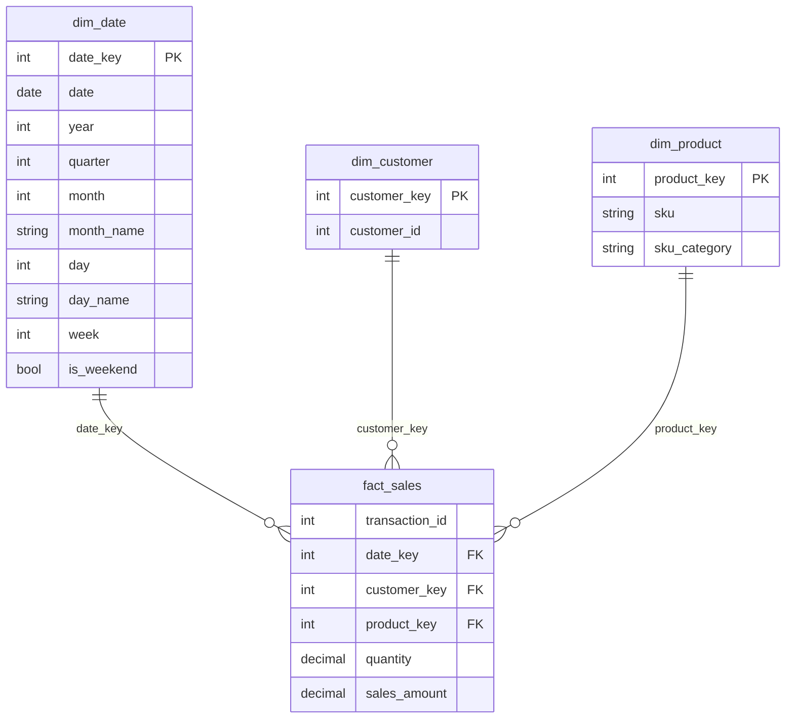

# Data Model Documentation

## Overview

The cleaned retail transaction data was transformed into a **star schema** to support SQL analysis, KPI reporting and the Power BI dashboard: one central fact table and three dimension tables.

## Dataset Grain

The source data represents individual SKU line items within customer transactions. The grain of `fact_sales` is therefore:

> **One SKU line item within one transaction on one date.**

A transaction can span several rows when several SKUs are bought. Checks on the loaded data:

| Check | Result |
|---|---|
| Fact rows (line items) | 131,706 |
| Distinct transactions | 64,682 |
| Line items per transaction | 2.04 on average, 21 at most |
| Customers per transaction | exactly 1 |
| Dates per transaction | exactly 1 |
| Repeated product within a transaction | none |

Because each transaction belongs to one customer on one date, **transactions can be counted with `COUNT(DISTINCT transaction_id)`** and attributed cleanly to customers and months. Counting rows would overstate transactions.

## Tables

### fact_sales
| Column | Type | Description |
|---|---|---|
| `transaction_id` | integer | Identifies the transaction. Repeats across line items |
| `date_key` | integer | Foreign key to `dim_date` |
| `customer_key` | integer | Foreign key to `dim_customer` |
| `product_key` | integer | Foreign key to `dim_product` |
| `quantity` | decimal | Quantity sold on the line (0.01 to 400) |
| `sales_amount` | decimal | Sales amount for the line |

**Note on quantity.** Quantity is fractional on 375 rows, which suggests some items are sold by weight or volume. "Units" are therefore not always item counts, and revenue per unit mixes different kinds of unit.

### dim_date
| Column | Type | Description |
|---|---|---|
| `date_key` | integer | Surrogate key (1 to 363) |
| `date` | date | Calendar date |
| `year` | integer | Year (2016) |
| `quarter` | integer | Quarter |
| `month` | integer | Month number (1 to 12) |
| `month_name` | text | Month name |
| `day` | integer | Day of month |
| `day_name` | text | Day name |
| `week` | integer | Week number |
| `is_weekend` | boolean | Weekend indicator |

**This is not a full calendar.** `dim_date` holds the 363 dates that appear in the data. January 1, March 27 (Easter Sunday) and December 25 have no rows, probably because the store was closed. Consequences:

- Days without sales do not appear as zero-revenue days.
- Per-day metrics use the number of dates in the table, so check them when comparing months.
- In Power BI the table cannot be marked as a date table (it has gaps), so the dashboard uses the `month` number instead of time-intelligence functions.

### dim_customer
| Column | Type | Description |
|---|---|---|
| `customer_key` | integer | Surrogate customer key |
| `customer_id` | integer | Original customer identifier |

The table holds 22,625 customers and no descriptive attributes, so all customer analysis is behavioral (frequency, recency, cohort).

### dim_product
| Column | Type | Description |
|---|---|---|
| `product_key` | integer | Surrogate product key |
| `sku` | text | Stock keeping unit (5,242 SKUs) |
| `sku_category` | text | Product category (187 categories, anonymized codes) |

## Relationships

All relationships are one-to-many from the dimension to the fact table, with single-direction filtering:

| From (one) | To (many) |
|---|---|
| `dim_date[date_key]` | `fact_sales[date_key]` |
| `dim_customer[customer_key]` | `fact_sales[customer_key]` |
| `dim_product[product_key]` | `fact_sales[product_key]` |

## Derived Fields Added in Power BI

These fields do not exist in the SQL model. They are calculated columns in the Power BI file and support the customer-flow and cohort pages. Full DAX is in `powerbi/dax_measures.md`.

| Table | Column | Purpose |
|---|---|---|
| `fact_sales` | `Sales Month` | Month number of each sale, from `dim_date` |
| `dim_customer` | `First Month` | Customer's first purchase month (the cohort) |
| `dim_customer` | `First Month Name` | Label for charts, sorted by `First Month` |
| `fact_sales` | `Is First Month Row` | Flags lines that belong to a customer's first month |
| `fact_sales` | `Cohort Age` | Months since the customer's first purchase |
| `dim_customer` | `Sept Status` | New, Continuing or Reactivated in September (or blank) |

**Customer-type definitions** (used consistently in SQL and Power BI):

- **New:** the customer's first recorded purchase is in that month.
- **Continuing:** active in the previous calendar month.
- **Reactivated:** seen earlier, but not active in the previous month.

Because the data begins on January 2, "new" means *first observed*, so January customers may have bought before.

## Why a Star Schema?

It is simple, fast for aggregation, and the same model serves SQL queries and Power BI. It lets the analysis:

- compare sales across dates and months,
- evaluate customer behavior and cohorts,
- compare products and categories, and
- calculate KPIs consistently from one fact table.

## Analytical Use

The model supports the project's downstream work:

- overall KPI and revenue performance,
- monthly revenue trends,
- product and category intelligence,
- customer intelligence and cohort retention,
- the revenue decline and recovery diagnosis, and
- the Power BI dashboard.